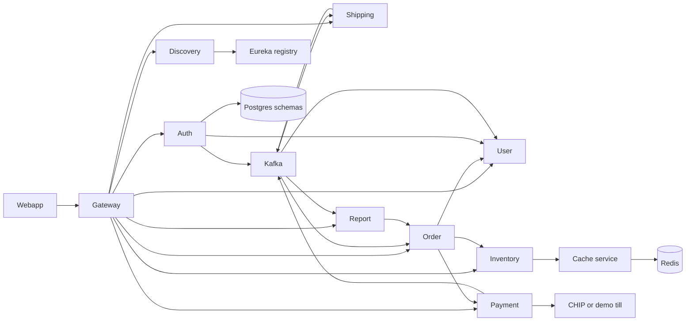

# Architecture

Apex Build is a PC-builder shop. The browser talks only to the gateway. Each bounded context has its own PostgreSQL database, and services talk over HTTP or Kafka.

## Services

| Service | Port | Database | Responsibility |
| --- | --- | --- | --- |
| gateway-service | 8080 | none | Spring Cloud Gateway, Keycloak JWT check, CORS, load balance |
| discovery-service | 8761 | none | Eureka plus a poller for health, CPU, heap, and disk |
| auth-service | 8081 | apex_auth | Accounts. The shop signs in through Keycloak; this service still accepts its own password tokens |
| user-service | 8082 | apex_user | Profile and addresses |
| inventory-service | 8083 | apex_inventory | Catalog, PC compatibility, stock reservations. Image files live in MinIO; the row stores `image_url` |
| order-service | 8084 | apex_order | Cart and checkout saga |
| payment-service | 8085, 8185, 8285 | apex_payment | CHIP Collect, or the demo till |
| shipping-service | 8086 | apex_shipping | Emulated courier |
| cache-service | 8087 | Redis | The only process that talks to Redis |
| report-service | 8088 | apex_report | Jasper sales PDFs from its own sales facts |

The gateway route `lb://payment-service` spreads calls across the three payment instances. Each response carries `X-Service-Instance`.

## Checkout saga

1. The order service re-quotes the cart with inventory. Incompatible builds are rejected.
2. It creates an order, then reserves stock.
3. It asks payment for a checkout URL.
4. If that call fails, it releases the stock and cancels the order.
5. A paid CHIP callback, or the demo confirm button, publishes `apex.payment.succeeded`.
6. Order marks the order paid and confirms the reservation. Shipping opens a tracking number.
7. A scheduler moves the shipment `CREATED → PICKED → PACKED → SHIPPED → IN_TRANSIT → OUT_FOR_DELIVERY → DELIVERED`.
8. Delivery publishes `apex.shipping.updated`, and the order becomes `FULFILLED`.

`apex.payment.failed` releases stock.

## CHIP

Live mode calls `POST https://gate.chip-in.asia/api/v1/purchases/` with `Authorization: Bearer $CHIP_SECRET_KEY`. Prices are minor units (cents). The callback checks the `X-Signature` header: base64 RSA PKCS#1 v1.5 over the raw body, SHA-256, using `CHIP_PUBLIC_KEY`. CHIP rejects callback URLs that include an explicit port, so `CHIP_SUCCESS_CALLBACK` must be public `https` on 443. Redirect URLs may use `localhost`.

`CHIP_MODE=demo` (the default) never calls CHIP. The shop shows `/pay/demo/{paymentId}`.

## Resilience and tracing

Outbound HTTP uses Resilience4j. A 4xx from another Apex service does not open the breaker. Cache misses fall through to the database. Every log line includes `traceId` and `spanId` from Micrometer and Brave. RestClient and the gateway propagate the W3C trace. Zipkin export stays off unless `ZIPKIN_ENABLED=true`.

## Memory

The run scripts default to about 160MB heap, Serial GC, and tiered compilation stopped at level 1. Kafka is capped at 256MB and Redis at 64MB. That is the profile intended for an 8GB Apple Silicon laptop. Set `APEX_JVM_PROFILE=full` on a larger machine.
